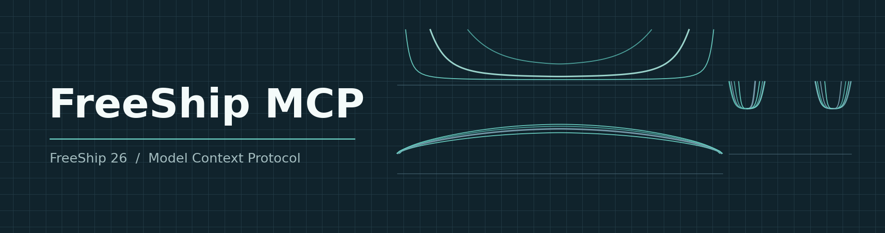
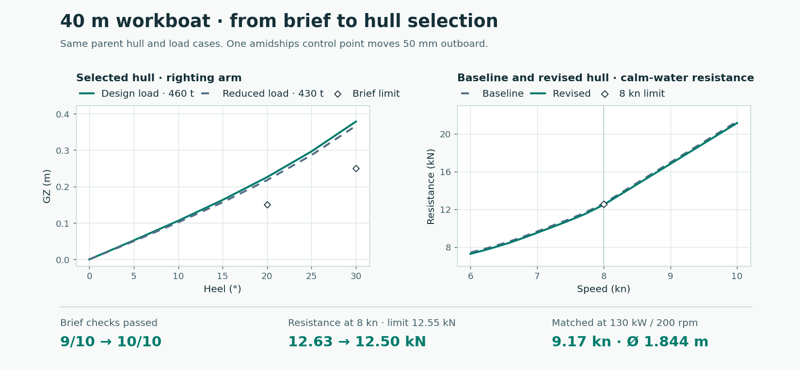

<a href="README.zh-CN.md">简体中文</a> · <strong>English</strong>

  

**FreeShip MCP connects an AI client to the native FreeShip 26 document service.** Read or edit a hull, compare loading and performance, and deliver an FBM model, DXF lines plan and a traceable assessment.

  <a href="#start"><strong>Quick start</strong></a> &nbsp;·&nbsp;
  <a href="#workboat">40 m workboat</a> &nbsp;·&nbsp;
  <a href="#tools">MCP tools</a> &nbsp;·&nbsp;
  <a href="#development">Development</a>

  <a href="https://github.com/jiangshirong/FreeShip-26/releases/latest">FreeShip 26 for Windows</a> &nbsp;·&nbsp;
  <a href="https://github.com/jiangshirong/FreeShip-MCP/tree/legacy/lazarus">Lazarus edition</a>

## From a design brief to a selected hull

  

The [example brief](examples/workboat-brief.json) evaluates two variants of the same synthetic hull. The baseline exceeds the **12.55 kN** resistance limit at **8 kn**. Moving one amidships control point **50 mm** outboard changes the computed resistance from **12.63 to 12.50 kN**. The revised hull passes all ten brief checks. The selected hull's B-series match gives **9.17 kn** at **130 kW and 200 rpm**.

To reproduce it, copy [synthetic-hull.fbm](examples/synthetic-hull.fbm) into the configured workspace. Give your client the example brief and call `run_design_brief` with `model_path: "synthetic-hull.fbm"` and a fresh `output_directory`, such as `workboat-study`. The server records the exact brief, candidate FBMs, calculation evidence and the selected hull's native DXF. The brief contains illustrative acceptance limits for preliminary design. Class rules, structural checks and real-vessel validation are separate work.

## Quick start

Use **Windows x64**, **Python 3.11+** and an installed [FreeShip 26 Windows runtime](https://github.com/jiangshirong/FreeShip-26/releases/latest). Point to `FreeShipDocumentService.exe` inside its installation directory so the service can find its companion executables and Qt libraries.

~~~powershell
git clone https://github.com/jiangshirong/FreeShip-MCP.git C:\MCP\FreeShip-MCP
cd C:\MCP\FreeShip-MCP
py -3.11 -m venv .venv
.\.venv\Scripts\python.exe -m pip install -r requirements-dev.lock
.\.venv\Scripts\python.exe -m pip install --no-deps --no-build-isolation -e .
New-Item -ItemType Directory -Force C:\HullWork
Copy-Item examples\synthetic-hull.fbm C:\HullWork\
~~~

Add a local stdio server in your MCP client. Adjust the paths to match your installation.

~~~json
{
  "mcpServers": {
    "freeship": {
      "command": "C:\\MCP\\FreeShip-MCP\\.venv\\Scripts\\python.exe",
      "args": [
        "-m", "freeship_mcp.server",
        "--workspace", "C:\\HullWork",
        "--fs26-service", "C:\\Users\\YourName\\AppData\\Local\\Programs\\FreeShip26Qt\\FreeShipDocumentService.exe"
      ]
    }
  }
}
~~~

Run the same command with `--check` to verify that the FS26 service starts and list the available tools. Try asking the client to inspect `synthetic-hull.fbm` and calculate hydrostatics at a draft of **3 m**. File paths are scoped to the workspace. Saved artifacts use new names and carry source provenance.

## MCP tools

| Task | Tools |
| --- | --- |
| Read and verify models | `engine_info`, `inspect_model`, `validate_model` |
| Model and refine a hull | `create_hull`, `edit_control_net`, `rebuild_hull`, `save_model` |
| Calculate hydrostatics and stability | `calculate_hydrostatics`, `inspect_loading_book`, `save_loading_book`, `calculate_stability` |
| Compare performance and match a propeller | `inspect_performance_inputs`, `calculate_performance`, `compare_resistance`, `calculate_propulsion_chain` |
| Deliver a design study | `export_linesplan_dxf`, `run_design_brief` |

`inspect_model(include_control_net=true)` returns the entity IDs and SHA-256 for the current file. Use that hash on edits, then inspect the saved copy before applying further edits. Model coordinates follow the model's units. Loading-book weights are in metric tonnes, coordinates and tank dimensions in metres, and tank fill in percent.

The FS26 backend exposes native van Oortmerssen, Hollenbach and Fung resistance methods and Wageningen B-series propulsion. `inspect_performance_inputs` lists the solver fields, units and ranges. The design-brief workflow uses Fung at the named load case's upright midpoint draft, within the brief's trim and upright GZ limits.

## Development and credits

- **FS26 integration tests.** Set `FREESHIP_MCP_TEST_FS26_SERVICE` to the full path of the installed document service, then run `.\.venv\Scripts\python.exe -m pytest -q -k "not standalone"` after building the legacy test engine. Its instructions and historical verification records are in the [development guide](docs/development.md) and [verification notes](docs/verification.md).
- **Legacy behavior.** Existing launches without `--fs26-service` select the Lazarus engine. This path requires the legacy engine built from source. The [Lazarus branch](https://github.com/jiangshirong/FreeShip-MCP/tree/legacy/lazarus) preserves the previous edition and its setup.
- **License.** [GPL-3.0-or-later](LICENSE). See [NOTICE](NOTICE) for FreeShip, FreeShip Plus and dependency attributions. The [original examples](examples/README.md) use synthetic geometry.

[Back to top](#top)
