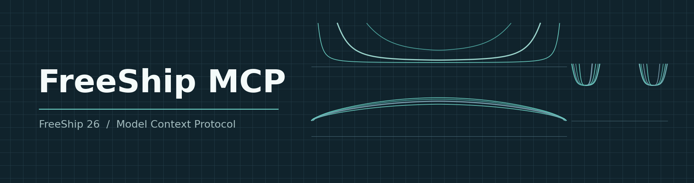
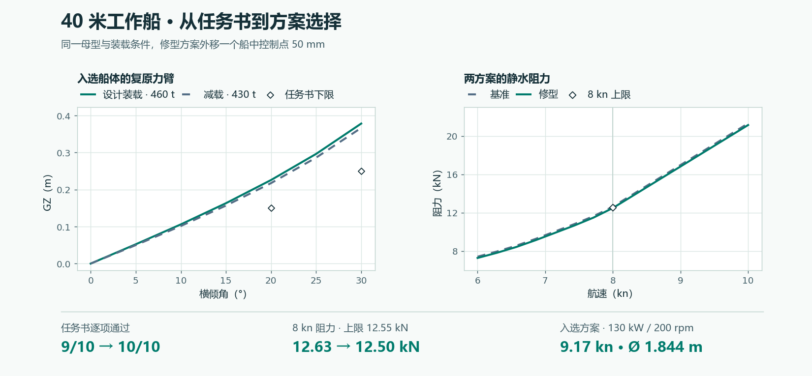

<strong>简体中文</strong> · <a href="README.md">English</a>

  

**FreeShip MCP 让 AI 客户端直接调用 FreeShip 26 的原生文档服务。** 读取和修整船模、比较装载工况与航行性能，再交付 FBM 船模、DXF 型线图和可追溯的计算记录。

  <a href="#start"><strong>快速开始</strong></a> &nbsp;·&nbsp;
  <a href="#workboat">40 米工作船算例</a> &nbsp;·&nbsp;
  <a href="#tools">工具总览</a> &nbsp;·&nbsp;
  <a href="#development">开发与致谢</a>

  <a href="https://github.com/jiangshirong/FreeShip-26/releases/latest">下载 FreeShip 26 Windows 版</a> &nbsp;·&nbsp;
  <a href="https://github.com/jiangshirong/FreeShip-MCP/tree/legacy/lazarus">Lazarus 版本</a>

## 从任务书到船型选择

  

[示例任务书](examples/workboat-brief.json) 用同一艘合成母型比较两套方案。基准方案在 **8 节**时的阻力超过 **12.55 kN** 上限。把船中一个控制点向外移 **50 mm** 后，计算阻力由 **12.63 kN** 降至 **12.50 kN**，修型方案通过全部十项任务书检查。在 **130 kW、200 rpm** 条件下，入选方案的 B 系列桨匹配航速是 **9.17 节**。

复算时，把 [synthetic-hull.fbm](examples/synthetic-hull.fbm) 放进配置好的工作目录。将示例任务书交给 MCP 客户端，调用 `run_design_brief`，把 `model_path` 设为 `synthetic-hull.fbm`，并指定新的 `output_directory`，例如 `workboat-study`。输出包括任务书、候选 FBM、逐项计算结果，以及入选船体的原生 DXF。算例阈值用于演示初步设计。正式规范、结构校核和实船验证属于独立工作。

## 快速开始

需要 **Windows x64**、**Python 3.11 或更高版本**和已安装的 [FreeShip 26 Windows 运行环境](https://github.com/jiangshirong/FreeShip-26/releases/latest)。请指向安装目录中的 `FreeShipDocumentService.exe`，服务会从该目录加载配套程序和 Qt 库。

~~~powershell
git clone https://github.com/jiangshirong/FreeShip-MCP.git C:\MCP\FreeShip-MCP
cd C:\MCP\FreeShip-MCP
py -3.11 -m venv .venv
.\.venv\Scripts\python.exe -m pip install -r requirements-dev.lock
.\.venv\Scripts\python.exe -m pip install --no-deps --no-build-isolation -e .
New-Item -ItemType Directory -Force C:\HullWork
Copy-Item examples\synthetic-hull.fbm C:\HullWork\
~~~

在 MCP 客户端添加本地 stdio 服务，并将路径改成自己的安装位置。

~~~json
{
  "mcpServers": {
    "freeship": {
      "command": "C:\\MCP\\FreeShip-MCP\\.venv\\Scripts\\python.exe",
      "args": [
        "-m", "freeship_mcp.server",
        "--workspace", "C:\\HullWork",
        "--fs26-service", "C:\\Users\\YourName\\AppData\\Local\\Programs\\FreeShip26Qt\\FreeShipDocumentService.exe"
      ]
    }
  }
}
~~~

在相同启动命令后追加 `--check`，可检查兼容性并查看 FS26 功能列表。第一次可以让客户端读取 `synthetic-hull.fbm`，计算 **3 m 吃水**下的静水力。文件路径限定在工作目录内，保存成果使用新文件名并记录来源。

## 工具总览

| 任务 | MCP 工具 |
| --- | --- |
| 读取和检查船模 | `engine_info`、`inspect_model`、`validate_model` |
| 建模与修型 | `create_hull`、`edit_control_net`、`rebuild_hull`、`save_model` |
| 静水力、装载与稳性 | `calculate_hydrostatics`、`inspect_loading_book`、`save_loading_book`、`calculate_stability` |
| 阻力对比与推进匹配 | `inspect_performance_inputs`、`calculate_performance`、`compare_resistance`、`calculate_propulsion_chain` |
| 型线图与设计交付 | `export_linesplan_dxf`、`run_design_brief` |

`inspect_model(include_control_net=true)` 返回当前文件的实体编号和 SHA-256。编辑时传入该哈希，继续编辑前重新读取保存的副本。建模坐标沿用船模单位。装载工况的重量用公吨，位置和液舱尺寸用米，装载率用百分数。

FS26 后端支持原生 van Oortmerssen、Hollenbach、Fung 阻力方法和 Wageningen B 系列推进计算。`inspect_performance_inputs` 提供字段、单位和取值范围。任务书流程使用指定工况在零横倾时的船中吃水，在任务书给出的纵倾和零横倾 GZ 限制内按零纵倾计算 Fung 阻力。

## 开发与致谢

- **FS26 集成测试。** 把 `FREESHIP_MCP_TEST_FS26_SERVICE` 设为文档服务的完整路径，构建旧版测试引擎后运行 `.\.venv\Scripts\python.exe -m pytest -q -k "not standalone"`。旧引擎构建和历史验证见[开发说明](docs/development.zh-CN.md)与[验证记录](docs/verification.zh-CN.md)。
- **旧配置兼容。** 未指定 `--fs26-service` 的启动命令继续选择从源码构建的 Lazarus 引擎。[Lazarus 分支](https://github.com/jiangshirong/FreeShip-MCP/tree/legacy/lazarus)保留了上一版与对应配置。
- **许可证。** [GPL-3.0-or-later](LICENSE)。原 FreeShip、FreeShip Plus 和依赖的版权说明见 [NOTICE](NOTICE)。[随附样船](examples/README.md)使用合成几何。

[返回顶部](#top)
